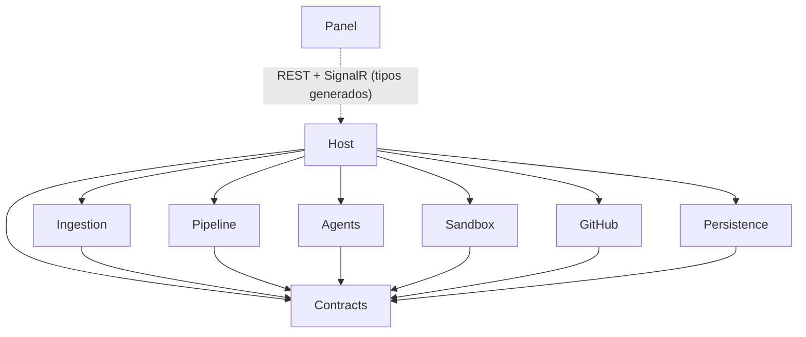
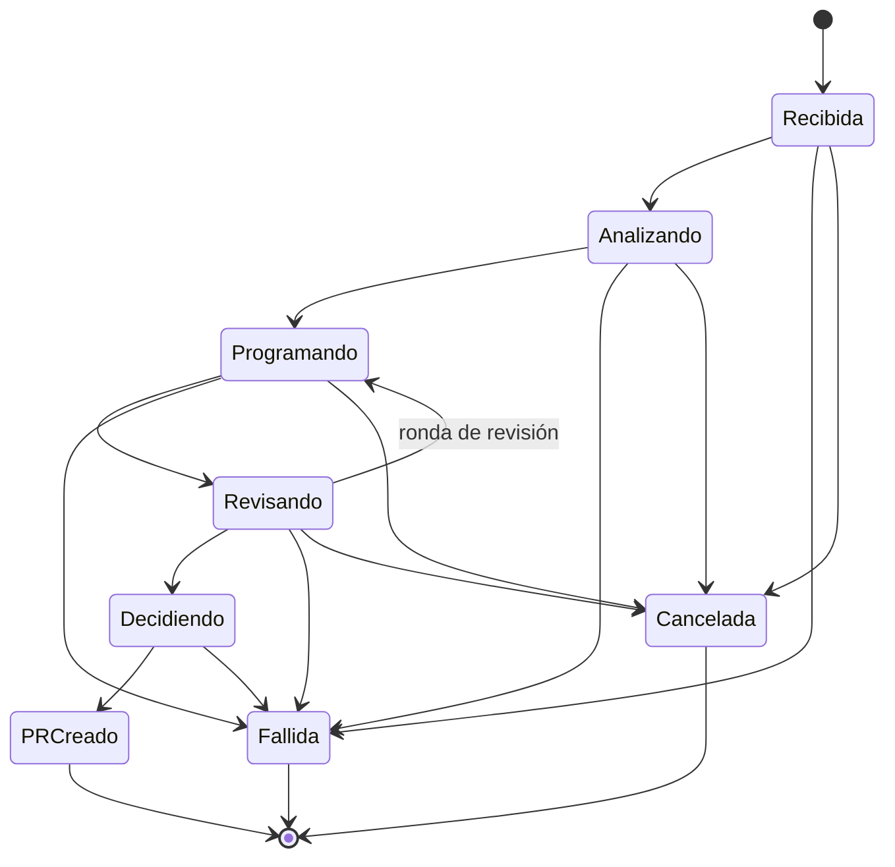
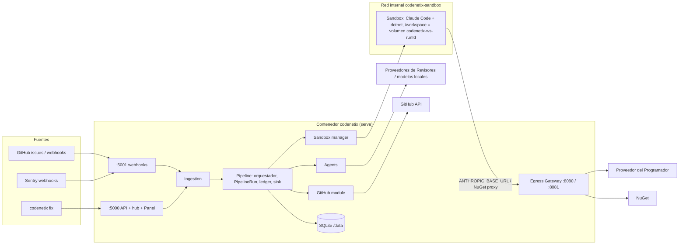
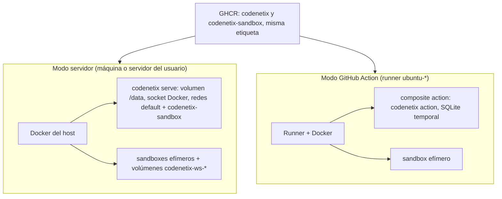
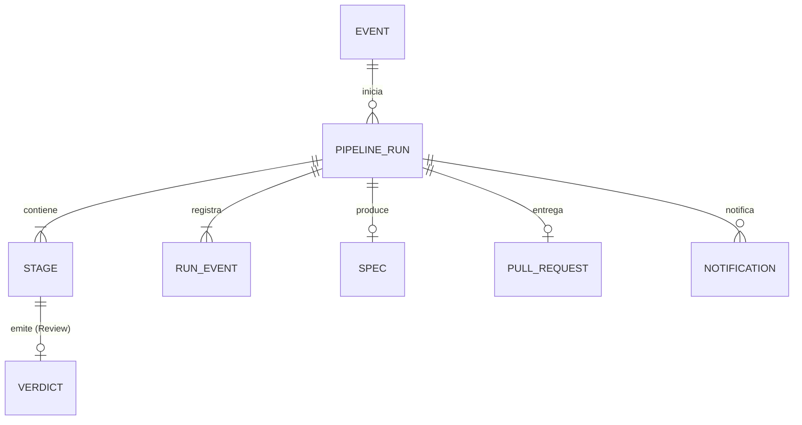

# Architecture Spine — CodeNetix v1

Los términos en cursiva son los del Glosario del PRD (§3). El código usa identificadores en inglés según la tabla de *Consistency Conventions*.

**Desviación respecto al PRD:** FR-25 decía que, en modo Action, el runner hace de Sandbox. Este spine usa el **mismo Sandbox Docker también en ese modo** (AD-12), que es más estricto y cumple FR-27. El PRD se actualiza en consecuencia.

## Design Paradigm

**Monolito modular con vertical slices.** Es un único proceso ASP.NET Core con API, hub de SignalR, workers en segundo plano y el Egress Gateway. Dentro de él, una *Ejecución* es un **pipeline pipes-and-filters** (Análisis → Programación → Pruebas → Revisión → Decisión) **gobernado por una máquina de estados explícita** (`PipelineRun`). El **orquestador de Pipeline** es el único que encadena las Etapas (AD-16). Los módulos se comunican solo mediante interfaces de `CodeNetix.Contracts`.

| Módulo | Responsabilidad | Proyecto | Tablas |
| --- | --- | --- | --- |
| Host | Arranque y modos, DI, acceso y autenticación, endpoints, hub, servir el Panel, `StartupReconciler` | `CodeNetix.Host` | — |
| Ingestion | Fuentes → `EventEnvelope`, firmas, autorización (FR-26), deduplicación, sondeo | `CodeNetix.Ingestion` | `ing_` |
| Pipeline | `PipelineRun`, Dispatcher, orquestador, `MergePolicy`, `IRunEventSink`, `IBudgetLedger`, `EffectiveConfig` | `CodeNetix.Pipeline` | `run_` |
| Agents | Analista y Revisores (`IReasoningAgent`), adaptador `ClaudeCodeAgent` (`ICodingAgent`) | `CodeNetix.Agents` | — |
| Sandbox | Contenedores, volúmenes de trabajo, `ITestRunner`, Egress Gateway | `CodeNetix.Sandbox` | — |
| GitHub | Clonado, diff, commit, push, PR, comentarios, permisos, lectura de `codenetix.yml` | `CodeNetix.GitHub` | `gh_` |
| Persistence | Cadena de conexión, ajustes de SQLite, orden de migraciones | `CodeNetix.Persistence` | — |
| Panel | SPA React compilada en `wwwroot` | `panel/` | — |

## Invariants & Rules



### AD-1 — Monolito modular con dependencias solo hacia Contracts [ADOPTED]

- **Binds:** all
- **Prevents:** acoplamiento cruzado y referencias circulares que impidan sustituir una pieza (otro agente programador, otro host de Git).
- **Rule:** cada módulo es un proyecto .NET que solo referencia `CodeNetix.Contracts`. Solo `CodeNetix.Host` referencia a todos para componer la DI. El proyecto `ArchitectureTests` hace fallar el build ante cualquier referencia entre módulos de negocio.

### AD-2 — `PipelineRun` es el único dueño del Estado; la cancelación es una petición [ADOPTED]

- **Binds:** FR-3, FR-9 a FR-19, FR-23, FR-24
- **Prevents:** estados imposibles, dos caminos de mutación y carreras entre la cancelación y una Etapa en curso.
- **Rule:**
  - **Quién cambia el Estado:** solo los métodos del agregado `PipelineRun`, que validan la tabla de transiciones del diagrama. Solo los invoca el orquestador de Pipeline.
  - **Transacción:** la unidad de trabajo es del orquestador. Cada transición se persiste en una transacción junto con su `RunEvent` (AD-3).
  - **Contadores:** los de Ronda y de intentos de Programación viven en `PipelineRun`.
  - **Fallos:** todo estado no terminal puede pasar a `Fallida` con un `FailureReason` de Contracts: `InvalidRepoConfig`, `CloneFailed`, `NotAutomatable`, `SchemaInvalid`, `TestsFailed`, `ReviewRejected`, `ReviewRoundsExhausted`, `BudgetExceeded`, `Timeout`, `HostRestarted`, `StageError`.
  - **Cancelación:** `IRunControl.RequestCancel(runId)` solo registra la petición (`RunEvent` `CancellationRequested`) y activa el `CancellationToken` de la Ejecución. El orquestador, al observarlo, llama a `Cancel()`. Un `StageResult` recibido con el token cancelado se descarta.
  - **`Decidiendo` no es cancelable:** `RequestCancel` en `Decidiendo` o en un estado terminal devuelve 409.



### AD-3 — Un único sumidero de `RunEvent`, solo para observar

- **Binds:** FR-20, FR-21, FR-22, NFR-5
- **Prevents:** que el Panel y el historial diverjan, que los módulos escriban eventos cada uno a su manera, o que un evento dispare efectos secundarios.
- **Rule:**
  - **Un único punto de escritura:** `IRunEventSink` (Contracts), implementado **solo** por Pipeline, dueño de `run_events`. Cualquier módulo que produzca algo observable (Sandbox, Gateway, Agents, GitHub) llama a `Append(runId, stageId?, payload)`.
  - **Qué hace el sumidero:**
    - aplica `ISecretRedactor` (AD-13);
    - asigna un `seq` monotónico por Ejecución;
    - agrupa la salida de terminal en lotes de hasta 250 ms;
    - publica en el hub **solo después del commit**.
  - **Reanudación del Panel:** reanuda con `GET /api/runs/<runId>/events?afterSeq=N`.
  - **Límite de salida:** como máximo 5 MB de salida por Etapa; al superarlo se emite un `OutputTruncated`. La retención por defecto es ilimitada y se puede configurar en días.
  - **Sin efectos:** los `RunEvent` **nunca** disparan efectos (comentarios, PR); esos son pasos explícitos del orquestador (AD-8).

### AD-4 — Ingestion normaliza, autoriza y deduplica; es la única entrada de trabajo

- **Binds:** FR-5, FR-6, FR-7, FR-8, FR-26
- **Prevents:** Ejecuciones duplicadas, Fuentes que se saltan la autorización y endpoints que crean Ejecuciones directamente.
- **Rule:**
  - **Normalización:** toda Fuente produce un `EventEnvelope` con Fuente, objeto (repo e issue, o issue de Sentry), clave de deduplicación, actor y payload tratado como datos.
  - **Antes de responder 2xx**, Ingestion:
    - verifica la firma (webhooks);
    - comprueba el permiso de escritura del actor en el Repositorio objetivo (FR-26);
    - persiste el Evento con una clave de deduplicación única.
  - **Rechazados:** quedan como `ignored` con su motivo.
  - **Creación de Ejecuciones:** solo el Dispatcher de Pipeline crea `PipelineRun`, con **como mucho una Ejecución no terminal por objeto**. Ningún endpoint crea Ejecuciones.
  - **Claves de deduplicación:**
    - GitHub (sondeo y webhook comparten clave): `gh:<owner>/<repo>#<issue>:labeled:<labelEventId>`.
    - Sentry: `sentry:<issueId>`, que se renueva como `sentry:<issueId>:regression:<n>` tras una regresión.
    - Manual: `manual:<url>:<requestId>`, con un `requestId` que genera el cliente.
  - **Fuente manual:** `codenetix fix` y el formulario del Panel llaman a `POST /api/events/manual` (Ingestion). El actor es la identidad del token de GitHub de la instancia.

### AD-5 — Dos tipos de agente con contratos de entrada cerrados

- **Binds:** FR-9, FR-10, FR-11, FR-14, FR-15, FR-16
- **Prevents:** que los Revisores vean el razonamiento del Programador, que un agente sin Sandbox ejecute código, o que el CLI cargue configuración no confiable del repositorio.
- **Rule:**
  - **`IReasoningAgent`** (Analista y Revisores):
    - Corre en el host y **nunca ejecuta código**.
    - Usa `IChatClient` (Microsoft.Extensions.AI / Agent Framework) con salida estructurada según los esquemas `Spec` y `Verdict` de Contracts.
    - Los reintentos por esquema inválido los aplica un decorador común (N configurable, 2 por defecto).
    - Admite Proveedores compatibles con OpenAI, incluidos los locales. Si el modelo no soporta salida estructurada, se pide el JSON en el prompt y se valida igual.
    - La entrada del Revisor es solo `Spec`, `Diff` y `TestReport`.
  - **`ICodingAgent`** (Programador):
    - Recibe un `ISandboxSession` y nunca crea contenedores.
    - En la v1, `ClaudeCodeAgent` ejecuta dentro del Sandbox: `claude --bare -p <prompt> --output-format json --permission-mode acceptEdits --allowedTools "Bash,Read,Edit,Write" --permission-prompts none --max-budget-usd <restante>`.
    - `--bare` es obligatorio, para no cargar los hooks ni los MCP del repositorio.
    - Cada actualización del CLI fijado se revisa contra su changelog.
  - **Texto del Evento:** siempre va en un bloque delimitado como datos, nunca en el *system prompt*.

### AD-6 — Sandbox efímero por Ejecución con volumen de trabajo con nombre

- **Binds:** FR-11, FR-12, FR-23, FR-24, FR-25, NFR-1, NFR-4
- **Prevents:** montajes vacíos (rutas del contenedor host interpretadas en el host), Sandboxes por Etapa, huérfanos y código ejecutado fuera del aislamiento.
- **Rule:**
  - **Dueño:** el orquestador de Pipeline crea `ISandboxSession` (vía `ISandboxManager.CreateForRun`) tras el clonado y la libera en el `finally` de la Ejecución completa. Ningún otro módulo crea ni destruye contenedores.
  - **Espacio de trabajo:** es un **volumen Docker con nombre** `codenetix-ws-<runId>`, nunca un *bind* de una ruta del contenedor host. Se monta en `/work` en el host y en `/workspace` en el Sandbox.
  - **El `.git` no se monta:** el módulo GitHub lo mantiene fuera y el Sandbox solo ve el árbol de trabajo.
  - **Contenedor:** se crea con la imagen `codenetix-sandbox`, a través del motor Docker del host, con límites de CPU, memoria y tiempo, y la etiqueta `codenetix.run=<runId>`.
  - **CLI del Programador:** la imagen pública **no** contiene `@anthropic-ai/claude-code`. La versión fijada se instala la primera vez en el volumen con nombre `codenetix-tools`, que se monta en solo lectura en cada Sandbox. Esa instalación pasa por el Egress Gateway, con el registro de npm en la lista de destinos permitidos solo durante ese paso.
  - **Cancelación:** al cancelarse el token, la sesión detiene el contenedor en 10 s como máximo.
  - **Pruebas:** `ITestRunner` (Sandbox) ejecuta `dotnet build` y `dotnet test` en el Sandbox y produce el `TestReport`. El resultado lo decide el orquestador, nunca lo que reporte el agente.

### AD-7 — Egress Gateway: el Sandbox no tiene internet y nunca ve secretos reales

- **Binds:** FR-2, FR-13, FR-27, NFR-1, NFR-2
- **Prevents:** la fuga de keys hacia el código del repositorio, las conexiones arbitrarias y dos implementaciones incompatibles del Gateway (MITM frente a proxy inverso).
- **Rule:**
  - **Red:** el Sandbox solo está en la red Docker `internal` `codenetix-sandbox`. El contenedor `codenetix` también se une a ella con el alias `gateway`.
  - **Proveedor del Programador:** el Gateway es un **proxy inverso HTTP** (YARP) en `http://gateway:8080/llm`, y el Sandbox tiene `ANTHROPIC_BASE_URL` apuntando a él.
    - Dentro del Sandbox, `ANTHROPIC_API_KEY=cnx-run-<runId>-<nonce>`, una key ficticia y única por Ejecución que sirve para atribuir el consumo.
    - El Gateway sustituye esa key por la real y retransmite el SSE sin acumularlo en buffer.
    - Lee el `usage` y lo carga en `IBudgetLedger` (AD-15).
  - **NuGet:** un proxy `CONNECT` en `http://gateway:8081` con una lista de destinos permitidos (los feeds configurados), sin inspeccionar el contenido.
  - **Destinos bloqueados:** cualquier otro destino se rechaza y se registra como `RunEvent`.
  - **Superficie mínima:** la interfaz del Gateway no expone ningún otro endpoint.

### AD-8 — Git y GitHub solo fuera del Sandbox; los efectos son pasos explícitos e idempotentes

- **Binds:** FR-10, FR-11, FR-17, FR-19, FR-26
- **Prevents:** que el token de GitHub llegue al Sandbox (incluso a través de `.git/config`), pushes o merges improvisados y comentarios duplicados.
- **Rule:**
  - **Operaciones del módulo GitHub:** solo él clona, fija el `BaseSha`, calcula el `Diff` contra el `BaseSha` (nunca contra `HEAD`), hace **un único commit** en `Decidiendo`, hace push de la rama `codenetix/<runId>`, abre el PR y comenta.
  - **Credenciales del clon:** el clon se autentica con `http.extraHeader` efímero. Antes de montar el árbol se verifica que no queda ninguna credencial en el árbol de trabajo.
  - **Guardián:** un único guardián rechaza cualquier push a la rama por defecto y cualquier merge.
  - **Efectos en GitHub** (PR, comentario en la issue al llegar a un estado terminal, etiquetas): los invoca el orquestador explícitamente y son idempotentes por `(runId, kind)`, registrados en `gh_notifications`.

### AD-9 — `MergePolicy` es una función pura y determinista

- **Binds:** FR-17, FR-18, NFR-6
- **Prevents:** que un LLM o un dato no reproducible influya en la clasificación.
- **Rule:**
  - `MergePolicy.Classify(PolicyInput) → RiskClass`, en Pipeline, sin E/S, LLM, reloj ni aleatoriedad.
  - **Entrada:** rutas cambiadas, líneas del diff, Rutas protegidas de la `EffectiveConfig`, Veredictos y Ronda.
  - **Destino en la v1:** siempre `CreatePullRequest`.
  - **Pruebas:** tests de tabla.

### AD-10 — Dos niveles de configuración; la configuración del repositorio se congela por Ejecución

- **Binds:** FR-2, FR-3, FR-5, FR-8, FR-13
- **Prevents:** que el Programador amplíe sus propios límites editando `codenetix.yml`, lecturas distintas en cada módulo y la dependencia circular entre Sentry y el repositorio.
- **Rule:**
  - **Configuración de instancia:** variables de entorno `CODENETIX__*` más el archivo opcional `/config/codenetix.instance.yml`. Contiene:
    - secretos;
    - Proveedores y tabla de precios por modelo (precio desconocido = "no estimable");
    - token de GitHub;
    - `Sentry:AuthToken` y `Sentry:BaseUrl`;
    - mapa de Sentry a repositorio;
    - concurrencia y exposición.
  - **Configuración de repositorio:** `codenetix.yml` (`version: 1`), validado contra el JSON Schema público `schemas/codenetix.v1.json`.
    - Lo lee **una sola vez** el módulo GitHub, desde el `BaseSha`, antes de `Analizando`.
    - Pipeline calcula la `EffectiveConfig`, en la que el repositorio solo puede **restringir** a la instancia, y la persiste como una instantánea inmutable en la Ejecución.
    - La `EffectiveConfig` se pasa como parámetro a las Etapas, al ledger y a `MergePolicy`.
    - Ningún módulo lee `codenetix.yml` del espacio de trabajo ni lo registra en la DI.
  - **Configuración inválida:** la Ejecución pasa a `Fallida(InvalidRepoConfig)`.

### AD-11 — Un archivo SQLite, un `DbContext` por módulo y dueños de tablas cerrados

- **Binds:** FR-1, FR-22, FR-24
- **Prevents:** que dos módulos escriban la misma tabla, migraciones que se pisan o copias divergentes de Spec o Veredictos.
- **Rule:**
  - **Archivo y ajustes:** un único `/data/codenetix.db` con WAL y `busy_timeout`.
  - **Contextos y migraciones:** cada módulo con tablas declara su propio `DbContext` en su proyecto, con su historial de migraciones `__ef_migrations_<prefijo>`. Persistence solo aporta la conexión, los ajustes y el orden de migración.
  - **Dueños:**
    - Ingestion → `ing_events`.
    - Pipeline → `run_runs`, `run_stages`, `run_specs`, `run_verdicts`, `run_events`, `run_budget`.
    - GitHub → `gh_pull_requests`, `gh_notifications`.
    - Agents y Sandbox no tienen tablas.
  - **Etapas:** una Etapa es `(stageId, runId, kind ∈ {Analysis, Coding, Testing, Review, Decision}, round, reviewer?)`, con **una Etapa `Review` por Revisor y por Ronda**.
  - **Fuente de verdad:** las tablas lo son; los `RunEvent` son su proyección observable.
  - **Secretos:** ningún secreto de terceros se persiste.

### AD-12 — Un binario, tres modos, la misma seguridad

- **Binds:** FR-1, FR-5, FR-25, FR-26
- **Prevents:** que algún modo se salte el Sandbox, el Gateway o la autorización.
- **Rule:**
  - **`codenetix serve`:** host completo.
  - **`codenetix fix <url>`:** cliente ligero que se ejecuta con `docker exec codenetix codenetix fix <url>`. Lee la URL y el `admin-token` del entorno y de `/data` del propio contenedor, y llama a `POST /api/events/manual`.
  - **`codenetix action`:** una Ejecución sin Panel y con SQLite temporal.
    - Construye un `EventEnvelope{Source=GitHubAction}` desde `GITHUB_EVENT_PATH` y pasa por Ingestion: sin firma, pero con FR-26.
    - Usa el mismo Pipeline, Sandbox y Gateway, sobre el Docker del runner.
    - Vuelca los `RunEvent` a la salida estándar.
  - **`action.yml`:** es una acción **`composite`** que lanza `ghcr.io/n3rvs/codenetix:<tag> action` con el socket de Docker del runner. Requiere un runner `ubuntu-*`.
  - **Token en modo Action:** `GITHUB_TOKEN` con permisos `contents`, `pull-requests` e `issues` de escritura. Se documenta que los PR que crea no disparan workflows.

### AD-13 — Un único redactor de secretos

- **Binds:** FR-2, FR-21, NFR-2
- **Prevents:** que un secreto aparezca por un camino olvidado.
- **Rule:**
  - `ISecretRedactor` se aplica dentro de `IRunEventSink` y en el sumidero de logs; los productores no redactan.
  - Conoce todos los secretos de la Configuración de instancia, incluidas las keys de los Revisores, y enmascara también los patrones de keys conocidos.

### AD-14 — El Panel solo usa contratos generados, también para el hub

- **Binds:** FR-20 a FR-23
- **Prevents:** tipos de frontend escritos a mano que divergen del backend.
- **Rule:**
  - **Tipos de `RunEvent`:** cada tipo tiene un DTO en Contracts dentro de una unión discriminada (`[JsonPolymorphic]` por `type`), publicada en el OpenAPI a través de `GET /api/runs/<runId>/events`.
  - **Hub:** `/hubs/runs` envía exactamente ese tipo.
  - **Panel:** importa solo los tipos TypeScript generados desde el OpenAPI.
  - **Prueba de contrato:** valida un ejemplo de cada tipo contra el esquema.

### AD-15 — `IBudgetLedger` es el único árbitro del presupuesto

- **Binds:** FR-13, FR-17, FR-22, NFR-5
- **Prevents:** contadores duplicados, gasto de Analista y Revisores sin contabilizar y cortes de presupuesto que parecen errores genéricos.
- **Rule:**
  - **Dueño:** `IBudgetLedger` es de Pipeline. El límite se congela en la `EffectiveConfig`.
  - **Cargos:** todo gasto de LLM pasa por `Charge(runId, source, tokensIn, tokensOut, cost)` y emite un `RunEvent` `TokensConsumed`. Hay dos vías:
    - el Gateway, para el Programador;
    - un middleware obligatorio de `IChatClient`, para el Analista y los Revisores.
  - **Presupuesto agotado (`Exhausted`):**
    - el Gateway responde `402` con el cuerpo `codenetix:budget_exhausted`;
    - el adaptador lo traduce a `StageOutcome.BudgetExhausted`;
    - el ledger solicita la cancelación cooperativa;
    - el orquestador aplica `Fallida(BudgetExceeded)`.
  - **Segunda barrera:** `--max-budget-usd` en el CLI.

### AD-16 — Secuencia canónica de una Ejecución

- **Binds:** FR-9 a FR-19
- **Prevents:** que distintos módulos de Etapa se llamen entre sí o que cambie el orden de los pasos.
- **Rule:** solo el orquestador de Pipeline encadena los pasos; ningún módulo de Etapa llama a otro. La secuencia es:
  1. GitHub: clonar, leer `codenetix.yml` desde el `BaseSha` y calcular la `EffectiveConfig`.
  2. `ISandboxManager.CreateForRun`.
  3. Analista: `Spec`.
  4. Para cada intento o Ronda:
     1. `ICodingAgent.RunAsync(session, spec, feedback, ct)`;
     2. `ITestRunner.RunAsync(session, ct)`;
     3. `IGitWorkspace.ComputeDiff(runId)`;
     4. Revisores en paralelo.
  5. `MergePolicy`.
  6. GitHub: commit, push y PR.
  7. Notificación.
  8. Liberar el Sandbox en el `finally`.

### AD-17 — Acceso: un único middleware y una sola decisión de exposición

- **Binds:** FR-4, FR-5, FR-7
- **Prevents:** endpoints que olvidan la autenticación, webhooks bloqueados por el token o un CLI sin credenciales.
- **Rule:**
  - **Interfaces:** el Host escucha en dos interfaces:
    - `:5000` para el Panel, `/api` y `/hubs`;
    - `:5001` para `/webhooks/*`, lo único que puede exponerse a internet.
  - **Autenticación:** `/api` y `/hubs` exigen siempre `Authorization: Bearer <admin-token>`.
    - El token se genera en el primer arranque en `/data/admin.token`, con permisos 0600.
    - El Panel lo pide una vez y lo guarda en el navegador.
  - **Exposición:** `CODENETIX__Host__Exposed=true` exige un `AccessToken` explícito; si falta, aborta el arranque.
  - **Webhooks:** solo verifican la firma.
  - **README:** publica `-p 127.0.0.1:5000:5000`.

### AD-18 — Arranque ordenado y estado de salud de la instancia

- **Binds:** FR-2, FR-24
- **Prevents:** workers que procesan con la configuración incompleta y limpiezas de arranque en un orden indeterminado.
- **Rule:**
  - **Orden de `StartupReconciler`** (Host):
    1. migraciones;
    2. validar la Configuración de instancia y publicar `IInstanceHealth` (`Ready | Diagnostic(reasons)`);
    3. Pipeline marca las Ejecuciones no terminales como `Fallida(HostRestarted)`;
    4. Sandbox elimina **todos** los contenedores con la etiqueta `codenetix.run` y los volúmenes `codenetix-ws-*`;
    5. se arrancan el Dispatcher y el sondeo.
  - **Modo `Diagnostic`:**
    - ningún `BackgroundService` procesa;
    - los webhooks responden 503;
    - el Panel muestra los motivos.
  - **Salud:** `GET /api/health` alimenta el `HEALTHCHECK` de la imagen.

## Consistency Conventions

| Concern | Convention |
| --- | --- |
| Nombres en el código | Evento → `EventEnvelope`; Ejecución → `PipelineRun`; Etapa → `Stage`; Veredicto → `Verdict`; Revisor → `Reviewer`; Política de merge → `MergePolicy`; Ruta protegida → `ProtectedPath`; Configuración de repositorio → `RepoConfig`; Configuración de instancia → `InstanceConfig` |
| Valores serializados (API, eventos, Panel) | Estados: `Received`, `Analyzing`, `Coding`, `Reviewing`, `Deciding`, `PullRequestCreated`, `Failed`, `Cancelled`. Veredicto: `Approved`, `ChangesRequested`, `Rejected`. Riesgo: `Minor`, `NeedsAttention`. Especialidades: `security`, `quality`, `tests`. Siempre en camelCase JSON |
| Claves de `codenetix.yml` | En inglés y en snake_case (`protected_paths`, `reviewers`, `max_review_rounds`, `budget_usd`). El esquema público es el contrato |
| Slices | `Features/<Verbo><Sustantivo>/`, con el handler, la validación y los tests juntos |
| IDs | `Guid.CreateVersion7()`; el `runId` corto (8 caracteres) solo para mostrar, nombrar ramas y nombrar volúmenes |
| Fechas | UTC, ISO 8601, `DateTimeOffset` |
| Errores de API | RFC 9457 `ProblemDetails` |
| Eventos | `type` en tiempo pasado (`StageStarted`, `VerdictIssued`, `StateChanged`, `TokensConsumed`, `OutputAppended`) |
| Logging y trazas | `Microsoft.Extensions.Logging` + OpenTelemetry; una traza por Ejecución con el atributo `runId` |
| Configuración | `IOptions<T>` por módulo; solo Host lee el entorno |
| Concurrencia | `CODENETIX__Pipeline__MaxConcurrentRuns`, 1 por defecto |
| Tests | Tests de tabla para la política y la máquina de estados; tests de integración con Docker para Sandbox, Gateway y GitHub; `ArchitectureTests` |

## Stack

| Name | Version |
| --- | --- |
| .NET SDK / ASP.NET Core (LTS) | 10.0 (SDK 10.0.402) |
| Microsoft.EntityFrameworkCore.Sqlite | 10.0.14 |
| Microsoft.Agents.AI (Agent Framework) | 1.26.0 |
| Microsoft.Extensions.AI | 10.11.0 |
| Docker.DotNet.Enhanced | 4.3.3 |
| Yarp.ReverseProxy | 2.3.0 |
| @anthropic-ai/claude-code (instalado la primera vez en `codenetix-tools`, no incluido en la imagen) | 2.1.311 |
| React | 19.3.1 |
| Vite | 8.3.5 |
| @xyflow/react (React Flow) | 12.12.0 |
| @xterm/xterm | 6.0.0 |
| @microsoft/signalr | 10.0.11 |
| Tailwind CSS | 4.3.3 |

## Structural Seed



**Despliegue y entornos**



- **Imágenes:** `codenetix` (base `aspnet:10.0`) y `codenetix-sandbox` (base `sdk:10.0` + Node, **sin** el CLI de Claude Code), para x64 y arm64, siempre con la misma etiqueta semver. Licencia del proyecto: Apache-2.0.
- **Persistencia:** el volumen `/data`. Las migraciones son solo hacia delante; el README recomienda copiar `/data` antes de actualizar.
- **Operación:** logs en la salida estándar y en el Panel; `HEALTHCHECK` sobre `/api/health`; sin telemetría ni servicios del mantenedor (NFR-3).
- **Release del proyecto:**
  - GitHub Actions: build, `ArchitectureTests`, tests de integración con Docker y `buildx` multiarquitectura.
  - Etiquetas `vX.Y.Z` y `vX.Y`; el README nunca usa `latest`.
  - Imágenes firmadas con cosign y con SBOM.
  - Dependabot o Renovate para las imágenes base y el CLI.
  - `SECURITY.md` con la política de divulgación.
  - El README documenta el riesgo del socket de Docker.

**Entidades principales**



```text
codenetix/
  src/
    CodeNetix.Contracts/      # interfaces, DTO, esquemas Spec/Verdict, unión RunEvent, FailureReason
    CodeNetix.Host/           # modos serve/fix/action, acceso, endpoints, hub, StartupReconciler, wwwroot
    CodeNetix.Ingestion/
    CodeNetix.Pipeline/       # PipelineRun, orquestador, Dispatcher, MergePolicy, ledger, sink
    CodeNetix.Agents/
    CodeNetix.Sandbox/        # gestor de contenedores, ITestRunner, Egress Gateway
    CodeNetix.GitHub/
    CodeNetix.Persistence/
  panel/                      # React + Vite
  schemas/codenetix.v1.json   # contrato público de codenetix.yml
  docker/                     # Dockerfile host, Dockerfile sandbox
  tests/                      # un proyecto por módulo + ArchitectureTests
  action.yml                  # composite action
```

## Capability → Architecture Map

| Capability / Area | Lives in | Governed by |
| --- | --- | --- |
| FR-1, FR-2 (arranque, configuración, diagnóstico) | Host, Persistence | AD-10, AD-11, AD-12, AD-13, AD-18 |
| FR-3 (`codenetix.yml`) | GitHub, Pipeline | AD-10, AD-2 |
| FR-4 (acceso) | Host | AD-17 |
| FR-5 a FR-8, FR-26 (Fuentes, autorización) | Ingestion, GitHub | AD-4, AD-17 |
| FR-9, FR-10 (Spec, rechazo temprano) | Agents, Pipeline | AD-5, AD-16 |
| FR-11, FR-12 (Programación, tests) | Sandbox, Agents | AD-5, AD-6, AD-7, AD-16 |
| FR-13 (presupuesto) | Pipeline | AD-15, AD-7 |
| FR-14 a FR-16 (Revisores, Rondas) | Agents, Pipeline | AD-2, AD-5, AD-16 |
| FR-17 a FR-19 (PR, riesgo, notificación) | Pipeline, GitHub | AD-8, AD-9, AD-16 |
| FR-20 a FR-23 (Panel, cancelación) | Host, Panel, Pipeline | AD-2, AD-3, AD-14 |
| FR-24 (reinicios) | Host, Pipeline, Sandbox | AD-18 |
| FR-25 (Action) | Host | AD-12 |
| FR-27, NFR-1, NFR-2 (seguridad) | Sandbox, GitHub | AD-6, AD-7, AD-8, AD-13 |
| NFR-4 (portabilidad) | docker/ | AD-6 (volúmenes con nombre), Despliegue |
| NFR-5 (observabilidad) | Pipeline | AD-3, AD-15 |
| NFR-6 (determinismo) | Pipeline | AD-9 |

## Deferred

- **Auto-merge:** `MergePolicy` ya clasifica el riesgo; el destino `Merge` llegará en la v2.
- **Otros `ICodingAgent` (Codex, OpenHands):** la interfaz de AD-5 ya los admite.
- **Reanudación desde la última Etapa:** en la v1, AD-18 marca las Ejecuciones como `Fallida(HostRestarted)`.
- **Postgres o varias instancias:** los `DbContext` por módulo de AD-11 facilitan el cambio.
- **Fuentes nuevas (Jira, Azure DevOps, GitLab, fallos de CI):** entran como nuevos productores de `EventEnvelope` (AD-4).
- **Seguridad del socket de Docker:** endurecerlo (proxy de socket, Docker sin root) y sacar el Gateway a un *sidecar* sin socket. En la v1 el riesgo se documenta y el Gateway se mantiene mínimo.
- **Detalles de implementación** (framework de tests, componentes de UI, librería de validación): no causan divergencia entre módulos.

## Open Questions

| # | Pregunta | Dueño | Antes de |
| --- | --- | --- | --- |
| OQ-1 | ✅ Resuelta (2026-10-27): cuenta de GitHub `N3rvs`; imágenes en `ghcr.io/n3rvs/` (GHCR exige minúsculas) | Longu | — |
| OQ-2 | ✅ Resuelta (2026-10-27): licencia **Apache-2.0** con DCO (`git commit -s`), sin CLA. `@anthropic-ai/claude-code` **no** se incluye en la imagen pública (su licencia no es open source): se instala la primera vez que se usa, en la máquina del usuario (ver AD-6) | Longu | — |
| OQ-3 | Tipo de token de GitHub en modo servidor: PAT *fine-grained* en la v1 frente a una GitHub App | Winston | Épica de GitHub |
| OQ-4 | Credenciales de feeds NuGet privados a través del Gateway | Winston | Si un repositorio piloto las necesita |
| OQ-5 | Soporte de Sentry autoalojado (`Sentry:BaseUrl` ya está previsto) | John | Épica de Sentry |
